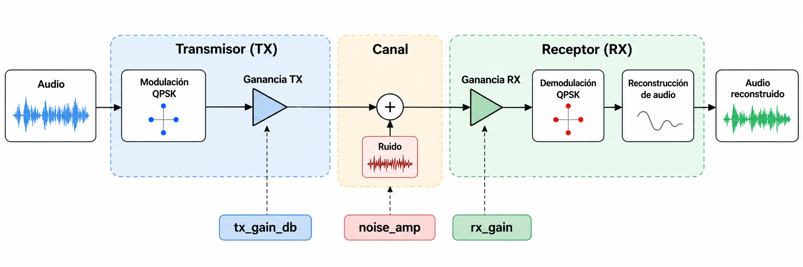

# Laboratorio 6: transmisión y recepción de audio QPSK

Este laboratorio estudia la transmisión digital de un audio mediante QPSK en
GNU Radio. El flujo convierte el audio a una representación de 8 bits, lo
modula, añade ruido gaussiano configurable y reconstruye la señal en el
receptor. El propósito es relacionar el nivel relativo de transmisión
(`tx_power_db`), el ruido del canal (`noise_amp`), la constelación recibida y
la fidelidad del audio reconstruido.

El modelo es una simulación educativa de banda base. No implementa una cadena
de radiofrecuencia completa, sincronización de portadora o tiempo, FEC ni una
medida directa de BER. Las métricas del audio permiten evaluar la
reconstrucción, pero no sustituyen la SNR del canal ni la BER.



## Requisitos

- Python 3.x.
- GNU Radio Companion 3.10 o posterior para abrir y ejecutar el flujo.
- Dependencias de análisis: `python -m pip install -r requirements.txt`.

## Uso

Ejecuta los comandos desde la raíz de este laboratorio:

1. Prepara la referencia. La fuente original se conserva como
   `data/entrada/audio_original.wav` y el resultado se guarda como
   `data/entrada/audio_demo.wav`:

   ```bash
   python src/preparar_audio.py "ruta/al/audio_original.wav"
   ```

   El flujo espera un WAV mono PCM16 a 44.100 Hz. La fuente original puede
   conservarse fuera del repositorio si tiene restricciones de uso.
2. Analiza el audio preparado y guarda la figura en `data/evidencia/`:

   ```bash
   python src/caracterizar_audio.py data/entrada/audio_demo.wav --guardar-graficas
   ```
3. Abre `src/lab6_tx_rx_audio_qpsk_mejorado.grc` en GNU Radio Companion.
   Ejecuta primero con `tx_power_db = 0 dB` y `noise_amp = 0`; después cambia
   una variable a la vez. La captura del receptor se escribe en
   `data/resultados/audio_rx_capture.wav`.
4. Detén el flujo antes de iniciar otra prueba para cerrar el WAV. Cambia el
   nombre de cada captura si deseas conservar varias condiciones.
5. Compara la referencia con una captura. Las figuras y métricas se guardan en
   `data/resultados/`:

   ```bash
   python src/comparar_audio_rx.py data/entrada/audio_demo.wav \
       data/resultados/audio_rx_capture.wav --max-segundos 20 --guardar
   ```

Consulta [`docs/CONTEXTO_LAB6_AUDIO_QPSK.md`](docs/CONTEXTO_LAB6_AUDIO_QPSK.md)
para la metodología, la interpretación de controles y la matriz experimental.
La plantilla del informe está en
[`docs/plantilla_informe_lab6.md`](docs/plantilla_informe_lab6.md).

## Organización

```text
.
├── README.md
├── requirements.txt
├── src/
│   ├── lab6_tx_rx_audio_qpsk_mejorado.grc
│   ├── QPSK_TX_RX.py
│   ├── preparar_audio.py
│   ├── caracterizar_audio.py
│   └── comparar_audio_rx.py
├── data/
│   ├── entrada/       # fuente original y WAV preparado que consume el flujo
│   ├── resultados/    # capturas RX, gráficas y métricas generadas
│   └── evidencia/     # figuras usadas para documentar el laboratorio
└── docs/
    ├── diagrama.png
    ├── CONTEXTO_LAB6_AUDIO_QPSK.md
    └── plantilla_informe_lab6.md
```

La carpeta `referencia/` se eliminó porque contenía copias obsoletas de
diagramas; el flujo vigente en `src/` es la fuente de verdad. No se generan
archivos de salida en la raíz.

## Precauciones

- No subas canciones protegidas por copyright sin autorización; usa audio
  libre o conserva la fuente únicamente de forma local.
- El archivo `.grc` es la fuente de verdad. Si se modifica en GNU Radio
  Companion, vuelve a generar `QPSK_TX_RX.py`.
